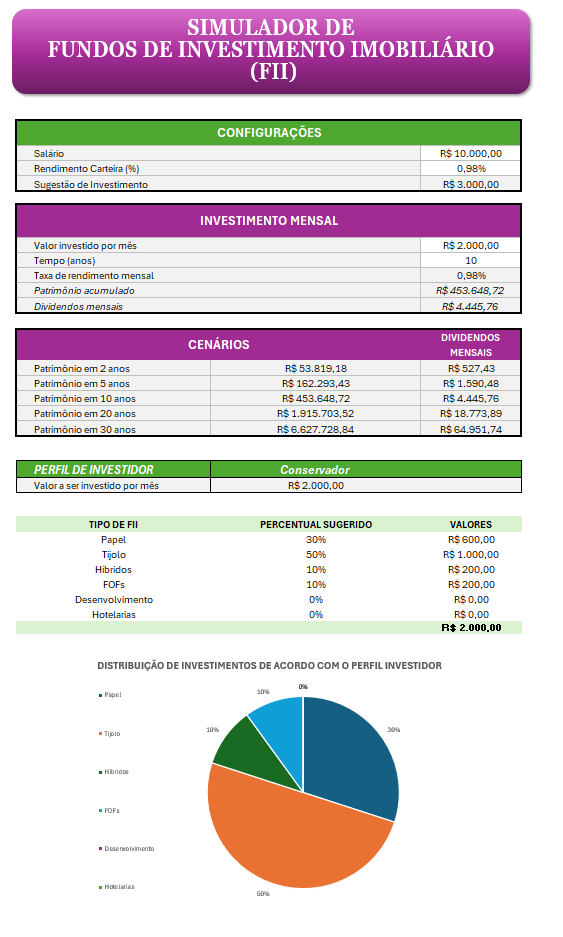
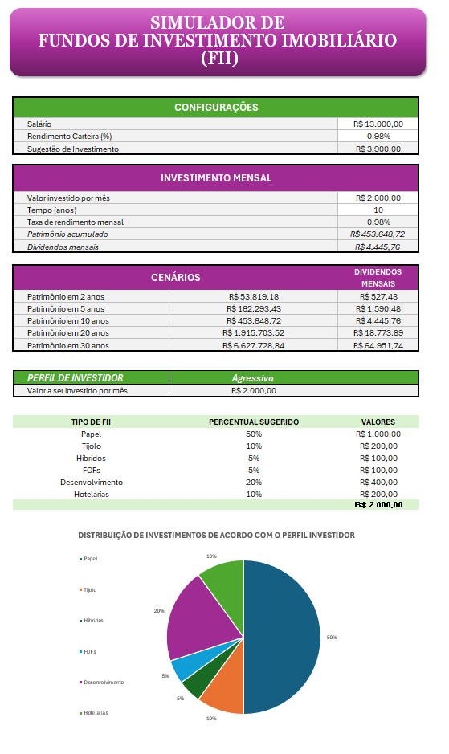

# Simulador de Investimentos em FIIs (Fundos Imobiliários)

Ferramenta interativa desenvolvida em Excel para simulação de aportes, projeção de rendimentos (dividendos) e comparação de carteiras de Fundos Imobiliários baseada em diferentes perfis de investidor.

---

## 1. Perguntas que a Ferramenta Responde (e Onde Encontrá-las)

Esta planilha foi desenhada para apoiar a tomada de decisão do investidor. Abaixo estão as principais perguntas respondidas pela ferramenta e a localização de cada uma:

* **Quanto vou receber de dividendos mensais ao longo do tempo?**
  * **Onde aparece:** Na aba `Investimento Mensal`, no campo `Dividendos mensais`. É possível visualizar o valor dos dividendos mensais calculados dinamicamente com base nas entradas do usuário nos campos `Rendimento Carteira` (aba `Configurações`), `Valor investido por mês` e `Tempo (anos)` (aba `Investimento Mensal`).

* **Qual o valor do patrimônio acumulado ao atingir a meta de aportes?**
  * **Onde aparece:** No painel `Investimento Mensal`, no campo `Patrimônio acumulado`, refletindo os parâmetros preenchidos pelo usuário.
  * Logo abaixo, há o painel de `Cenários`, onde o usuário tem uma visão consolidada do patrimônio acumulado e dos dividendos mensais em horizontes pré-definidos (2, 5, 10, 20 e 30 anos) para análise comparativa.

* **Como a minha carteira se comporta sob diferentes estratégias de risco?**
  * **Onde aparece:** Na seção de comparação de perfis, onde é possível selecionar o perfil de investidor entre **Conservador**, **Moderado** e **Agressivo**. A ferramenta exibe a sugestão de distribuição percentual e financeira do aporte para cada categoria de FII conforme a escolha.
  * Acompanha a seção um gráfico de pizza para facilitar a visualização da alocação de ativos.

---

## 2. Aplicação de Fórmulas Avançadas (`VF` e `PROCV`)

Para garantir automação, precisão e escalabilidade dos cálculos, foram utilizadas funções essenciais do Excel:

* **`VF` (Valor Futuro):**
  * **Finalidade:** Utilizado na modelagem financeira para projetar o crescimento do capital acumulado ao longo do tempo, considerando aportes mensais constantes e o reinvestimento dos proventos à taxa de rentabilidade informada.
  * **Sintaxe aplicada:** `=VF(taxa; nper; pmt; [vp]; [tipo])`

* **`PROCV` (Procura Vertical):**
  * **Finalidade:** Utilizado para buscar dinamicamente na tabela de apoio as porcentagens recomendadas de alocação por categoria de FII, com base no perfil de risco selecionado pelo usuário.
  * **Sintaxe aplicada:** `=PROCV(valor_procurado; matriz_tabela; 4; FALSO)`

---

## 3. Intervalos Nomeados Criados

O uso de intervalos e células nomeadas foi adotado como boa prática para tornar as fórmulas legíveis, autoexplicativas e fáceis de auditar:

* `CONFIGURAÇÕES`: Armazena os dados cadastrais e premissas inseridas pelo usuário (ex.: salário e taxa de rendimento da carteira), além do valor de investimento sugerido calculado com base na meta recomendada (30% da renda).
* `INVESTIMENTO_MENSAL`: Intervalo que consolida o aporte mensal, horizonte em anos, taxa aplicada, patrimônio final acumulado e dividendos projetados.
* `CENÁRIOS`: Intervalo estruturado com a projeção comparativa de patrimônio e renda passiva nos marcos temporais de 2, 5, 10, 20 e 30 anos.
* `PERFIL_INVESTIDOR`: Intervalo dinâmico onde são calculados o percentual e o valor monetário sugerido para cada tipo de ativo de acordo com o perfil selecionado.
* **Células Nomeadas:** Células-chave receberam identificadores diretos nas fórmulas (exemplo: a célula que recebe o valor do aporte mensal foi nomeada diretamente como `aporte`).

---

## 4. Perfis de Investidor e Critérios de Alocação

A ferramenta distribui os recursos considerando três estratégias de tolerância ao risco, estruturadas com fins didáticos:

* **Conservador:** Foco em previsibilidade de renda, segurança patrimonial e menor volatilidade, priorizando fundos de tijolo consolidados e fundos de papel com garantias sólidas.
  * **Distribuição:** 30% Papel | 50% Tijolo | 10% Híbridos | 10% FOFs
* **Moderado:** Busca pelo equilíbrio entre renda recorrente e potencial de valorização do patrimônio no médio/longo prazo.
  * **Distribuição:** 32% Papel | 40% Tijolo | 8% Híbridos | 10% FOFs | 5% Desenvolvimento | 5% Hotelarias
* **Agressivo:** Maior aceitação de risco e oscilação de cotas em troca de maiores retornos esperados, aumentando a exposição a desenvolvimento e outros segmentos táticos.
  * **Distribuição:** 50% Papel | 10% Tijolo | 5% Híbridos | 5% FOFs | 20% Desenvolvimento | 10% Hotelarias

---

## 5. Demonstração Prática (Simulação por Perfil)

### Simulação: Perfil Conservador

### Simulação: Perfil Agressivo

---

## Como Utilizar

1. Faça o download ou clone do arquivo `app_simulador_fii.xlsx` deste repositório.
2. Abra o arquivo no Microsoft Excel (habilite a edição e cálculos automáticos, caso solicitado).
3. No painel **Configurações**, preencha os campos `Salário` e `Rendimento Carteira (%)`.
4. No painel **Investimento Mensal**, insira o `Valor investido por mês` e o `Tempo (anos)`.
5. No painel **Perfil Investidor**, selecione o perfil desejado (**Conservador**, **Moderado** ou **Agressivo**) para visualizar instantaneamente o plano de distribuição dos aportes e os gráficos atualizados.

---

Feito com 💜 por Bruna Stefhany Pena
